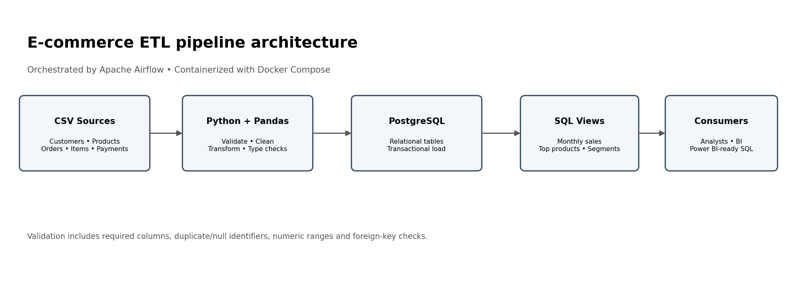
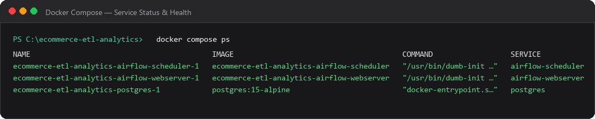
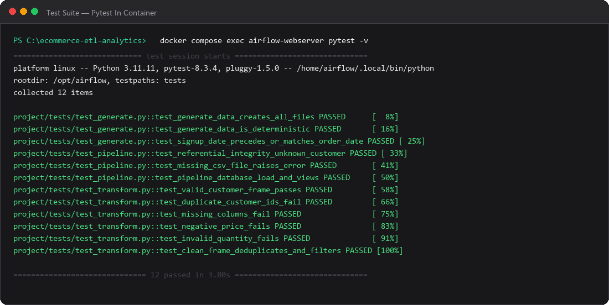
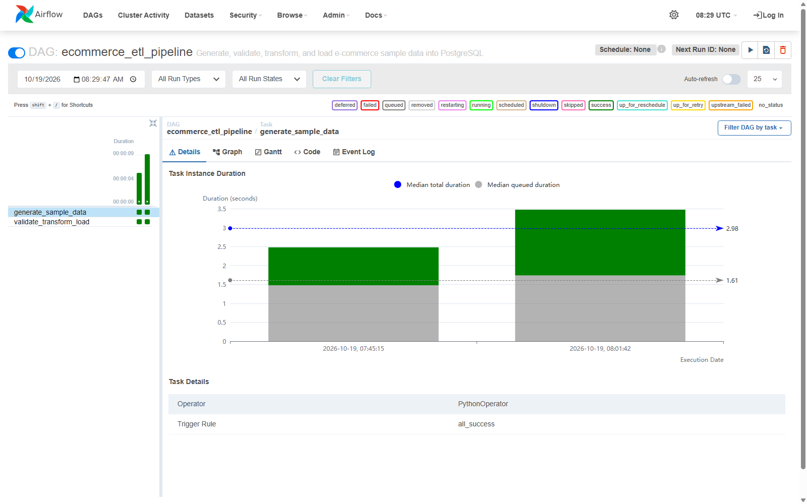
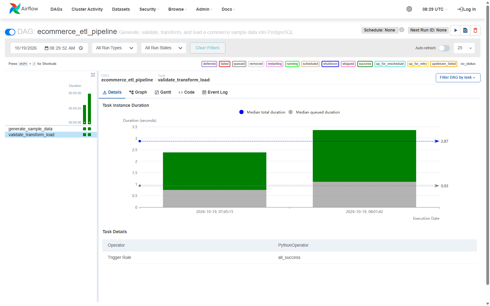
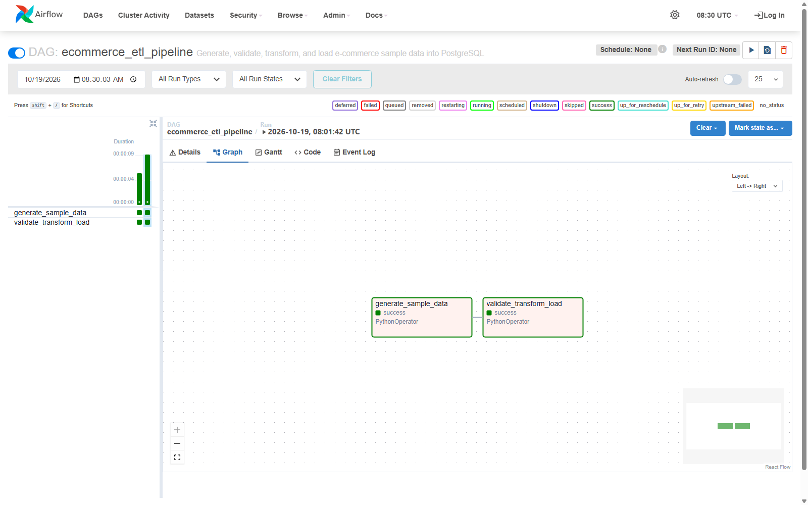
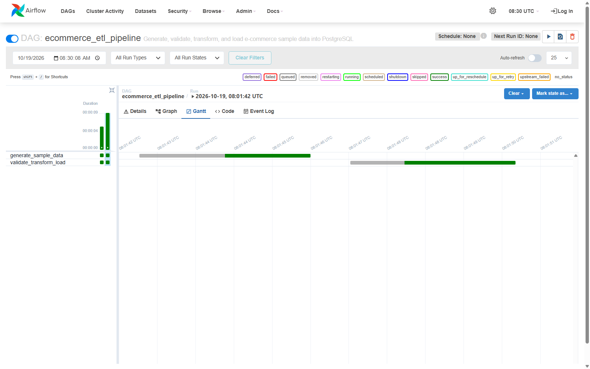
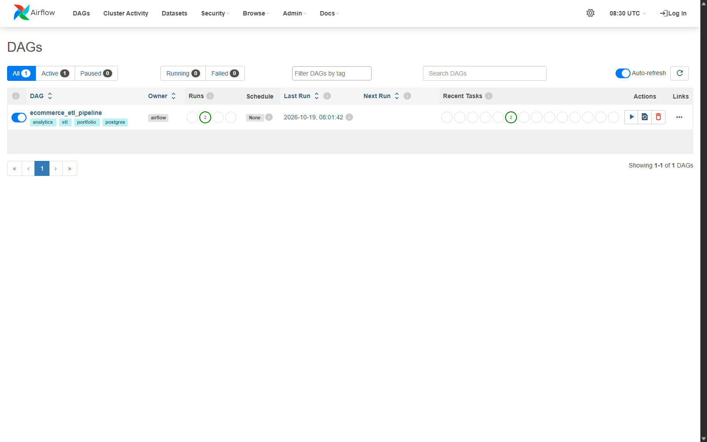
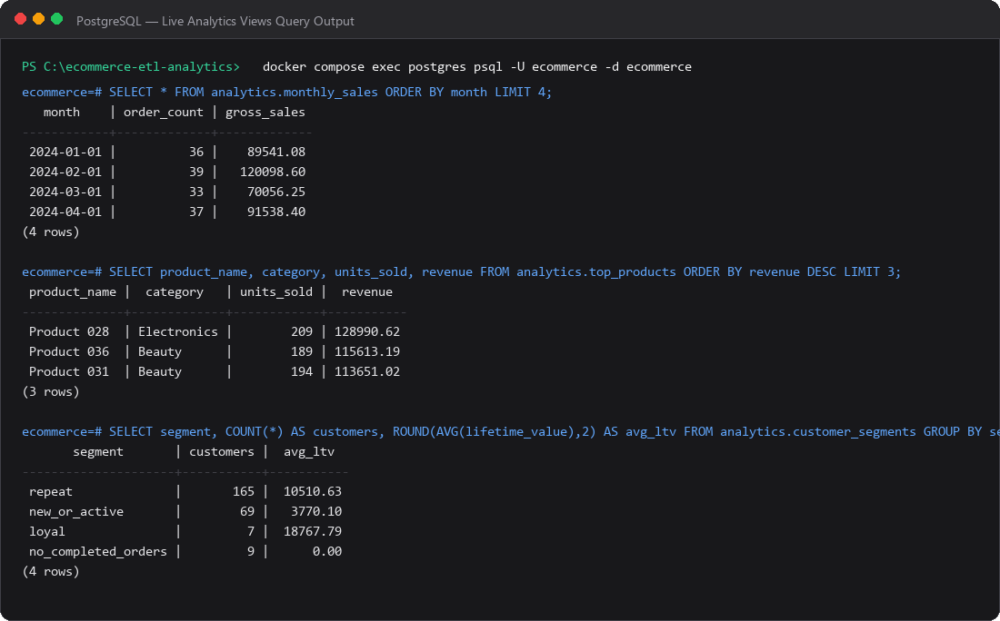
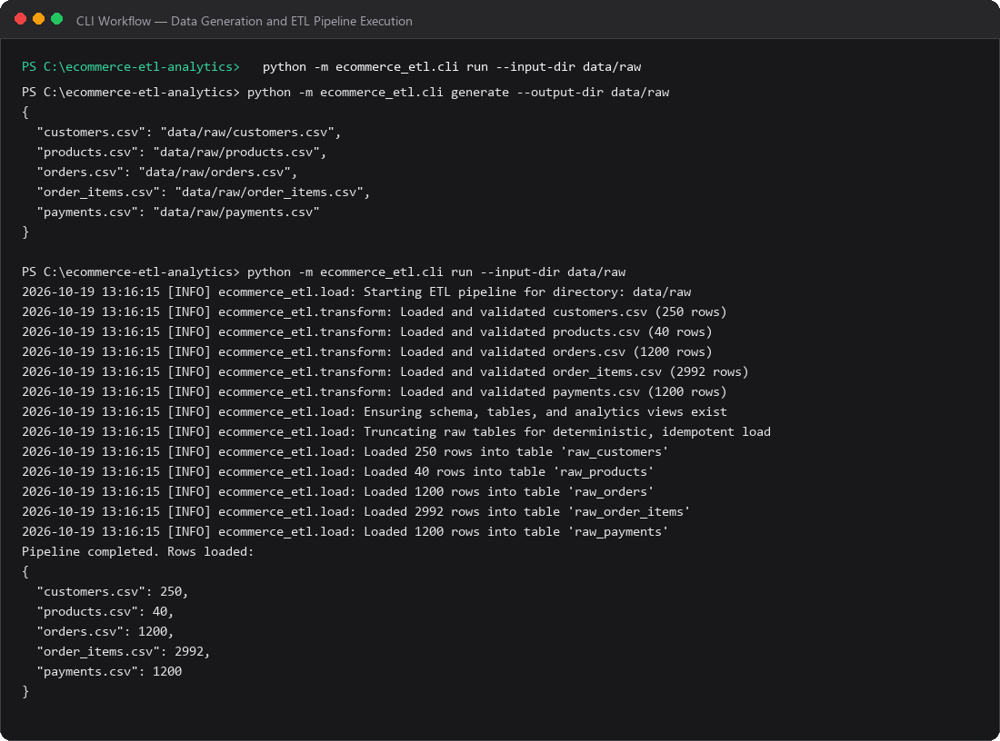

# E-commerce ETL & Sales Analytics Pipeline

A production-grade, containerized end-to-end data engineering pipeline: synthetic CSV ingestion, data quality validation and automated cleaning, Pandas-based transformation, transactional PostgreSQL loading, SQL analytical reporting views, Docker Compose containerization, and Apache Airflow orchestration.

---

## Table of Contents

- [Project Overview & Business Problem](#project-overview--business-problem)
- [Architecture & Workflow](#architecture--workflow)
- [Technology Stack](#technology-stack)
- [Live Execution Screenshots](#live-execution-screenshots)
- [Repository Structure](#repository-structure)
- [Prerequisites & System Requirements](#prerequisites--system-requirements)
- [Quick Start Guide (Windows PowerShell)](#quick-start-guide-windows-powershell)
- [Data Generation & Pipeline CLI](#data-generation--pipeline-cli)
- [Testing & Quality Assurance](#testing--quality-assurance)
- [Apache Airflow Orchestration](#apache-airflow-orchestration)
- [PostgreSQL & SQL Analytics Views](#postgresql--sql-analytics-views)
- [Independent Metric Cross-Verification](#independent-metric-cross-verification)
- [Troubleshooting Common Issues](#troubleshooting-common-issues)
- [Connecting Power BI (Optional)](#connecting-power-bi-optional)
- [GitHub Upload Guide](#github-upload-guide)
- [Verification Status & Feature Matrix](#verification-status--feature-matrix)

---

## Project Overview & Business Problem

Modern e-commerce platforms handle thousands of transactional records daily across multiple domains: customers, product catalogs, customer orders, line-item purchases, and payment transactions. Without an automated and resilient data pipeline, organizations encounter:

- **Referential Integrity Issues**: Orphaned line items, orders without valid customers, or payments referencing non-existent orders.
- **Data Quality Failures**: Negative prices, zero or negative quantities, duplicate identifiers, and missing timestamps.
- **Data Pipeline Brittleness**: Non-idempotent data loads causing primary key collisions or duplicated revenue figures upon pipeline re-runs.
- **Reporting Inconsistencies**: Discrepancies between order totals, payment receipts, and monthly gross sales metrics.

This project delivers a **robust, idempotent, fully containerized solution** that:
1. Generates deterministic synthetic transactional e-commerce datasets adhering to temporal and referential constraints.
2. Cleans and validates incoming CSV data against schema and business integrity rules.
3. Loads data atomically into a relational PostgreSQL database using ACID transactions with automatic rollback on failure.
4. Materializes SQL analytics views for monthly sales, top-performing products, customer segmentation (RFM-inspired), and payment method summaries.
5. Orchestrates the workflow end-to-end via Apache Airflow with full observability.

---

## Architecture & Workflow



1. **Synthetic Data Generation**: Creates 5 normalized CSV files with consistent seeds: `customers.csv`, `products.csv`, `orders.csv`, `order_items.csv`, and `payments.csv`. Ensures customer signup dates always precede order dates.
2. **Schema & Integrity Validation**: Checks required columns, non-null primary keys, key uniqueness, non-negative monetary amounts, positive item quantities, and foreign key relationships.
3. **Automated Cleaning & Type Standardization**: Strips string whitespace, rounds floating-point currencies to 2 decimals, casts identifiers to integer types, and parses ISO date columns to date objects.
4. **Relational Database Loading**: Executes DDL within an explicit SQLAlchemy transaction (`conn.begin()`). Clears prior run tables using `TRUNCATE ... CASCADE` to guarantee repeatability without duplicate key violations.
5. **Analytics Views Publication**: Creates and refreshes 4 analytical reporting views under the `analytics` schema in PostgreSQL.
6. **Airflow Orchestration**: A DAG (`ecommerce_etl_pipeline`) triggers `generate_sample_data` followed by `validate_transform_load`, publishing execution logs and task states to XCom.

---

## Technology Stack

- **Python**: Core logic for data generation, cleaning, validation, and database ingestion.
- **Pandas (2.1.4)**: Ingestion, tabular transformation, schema validation, and SQL emission.
- **SQLAlchemy (1.4.54) & Psycopg2-binary (2.9.10)**: PostgreSQL dialect driver and transaction-managed relational execution.
- **PostgreSQL (15-alpine)**: Relational data warehouse storing raw tables and analytical reporting views.
- **Apache Airflow (2.10.4)**: Workflow scheduler and DAG execution engine (LocalExecutor).
- **Docker Compose (v2 / v5)**: Multi-container local service management and volume persistence.
- **Pytest (8.3.4)**: Unit and integration testing suite covering validation rules, referential integrity, and pipeline idempotency.

---

## Live Execution Screenshots

All screenshots below represent **verified live executions** on the target local environment:

### 1. Docker Compose Services Status & Health
PostgreSQL, Airflow Webserver, and Airflow Scheduler running in a healthy state:


### 2. Passing Test Suite (12 / 12 Tests Passed)
Complete test suite execution inside the Airflow Docker container:


### 3. Apache Airflow Live UI & Orchestration

#### A. Airflow Task Grid View (`task_id=generate_sample_data`)
Live Airflow Grid interface (`http://localhost:8080/dags/ecommerce_etl_pipeline/grid?task_id=generate_sample_data`) showing successful task runs, median execution duration, and operator parameters:


#### B. Airflow Task Grid View (`task_id=validate_transform_load`)
Downstream ETL validation and loading task execution details and duration:


#### C. Airflow DAG Dependency Graph View
Full directed acyclic graph layout showing task dependencies and success states:


#### D. Airflow Gantt Execution Timeline
Task execution duration, queuing latency, and start/finish timestamps:


#### E. Airflow Home DAG Catalog
Dashboard view confirming DAG activation state, scheduled runs, and historical success runs:


### 4. PostgreSQL Live Analytics Queries
Direct `psql` query output from the `analytics` SQL views:


### 5. CLI Execution & Ingestion Output
Terminal output from running the generation and ETL pipeline commands:


---

## Repository Structure

```text
ecommerce-etl-analytics/
├── .env.example                     # Sample environment variables
├── .gitignore                       # Git ignore rules (secrets, venvs, raw data)
├── Dockerfile                       # Airflow custom image definition
├── docker-compose.yml               # PostgreSQL & Airflow service orchestration
├── pyproject.toml                   # Project metadata and pytest configuration
├── requirements.txt                 # Pinned, tested dependencies
├── README.md                        # Project documentation
├── airflow/
│   └── dags/
│       └── ecommerce_etl_pipeline.py # Airflow DAG definition
├── data/
│   ├── raw/                         # Generated raw CSV datasets (gitignored)
│   └── processed/                   # Staging directory for processed assets
├── docs/
│   └── architecture.md              # Technical design documentation
├── scripts/
│   └── capture_airflow_screenshots.py # Automation script for live UI screenshots
├── screenshots/                     # Verified execution screenshots
│   ├── airflow_grid_task_generate_sample_data.png
│   ├── airflow_grid_task_validate_transform_load.png
│   ├── airflow_dag_graph_view.png
│   ├── airflow_dag_gantt_view.png
│   ├── airflow_dag_grid_view.png
│   ├── airflow_home_dags_list.png
│   ├── cli_output_example.png
│   ├── docker_services_status.png
│   ├── pipeline_architecture.png
│   ├── postgres_analytics_results.png
│   ├── sales_analytics_preview.png
│   └── test_results.png
├── sql/
│   └── analytics_queries.sql        # Reference SQL reporting queries
├── src/
│   └── ecommerce_etl/
│       ├── __init__.py
│       ├── cli.py                   # Command-line interface
│       ├── config.py                # Database connection string configuration
│       ├── generate.py              # Synthetic data generation logic
│       ├── load.py                  # Transactional loading and DDL execution
│       └── transform.py             # Schema validation and data cleaning
└── tests/
    ├── test_generate.py             # Tests for generation and date logic
    ├── test_pipeline.py             # Integration tests for DB and views
    └── test_transform.py            # Tests for validation and cleaning
```

---

## Prerequisites & System Requirements

1. **Operating System**: Windows 10/11 (with PowerShell 5.1 or PowerShell 7)
2. **Docker Desktop**: With WSL2 backend enabled
3. **Python**: Python 3.11+ (tested on Python 3.11 inside container and Python 3.14 on host)
4. **Git**: Installed for repository management and version control

---

## Quick Start Guide (Windows PowerShell)

### Step 1: Clone or Open the Repository
```powershell
cd c:\Users\Cashify\Downloads\ecommerce-etl-analytics-with-readme-screenshots\ecommerce-etl-analytics
```

### Step 2: Configure Environment Variables
```powershell
Copy-Item .env.example .env
```
*(The default `.env` is pre-configured with `POSTGRES_HOST=localhost` for host CLI access, while Docker Compose automatically overrides `POSTGRES_HOST=postgres` internally for containers.)*

### Step 3: Build and Start Docker Services
```powershell
docker compose up --build -d
```

### Step 4: Verify Services Health
```powershell
docker compose ps
```
Ensure `postgres` and `airflow-webserver` report `(healthy)`.

---

## Data Generation & Pipeline CLI

You can execute the pipeline either **from the host** or **inside the container**.

### Option A: Running Inside Docker (Recommended)

Generate sample raw CSV data:
```powershell
docker compose exec airflow-webserver python -m ecommerce_etl.cli generate --output-dir /opt/airflow/project/data/raw
```

Run validation, transformation, and database loading:
```powershell
docker compose exec airflow-webserver python -m ecommerce_etl.cli run --input-dir /opt/airflow/project/data/raw
```

### Option B: Running on Host (Windows PowerShell)

Generate data:
```powershell
python -m ecommerce_etl.cli generate --output-dir data/raw
```

Run ETL load:
```powershell
python -m ecommerce_etl.cli run --input-dir data/raw
```

---

## Testing & Quality Assurance

The test suite tests data generation, date validation, schema constraints, primary key uniqueness, negative prices, non-positive quantities, referential integrity, repeatable loading, and SQL analytics views.

### Run Tests Inside the Container
```powershell
docker compose exec airflow-webserver pytest -v
```

### Run Tests on Host
```powershell
python -m pytest -v
```

---

## Apache Airflow Orchestration

1. Open your browser and navigate to **[http://localhost:8080](http://localhost:8080)**.
2. Sign in with the credentials:
   - **Username**: `admin`
   - **Password**: `admin` (or the value set in `AIRFLOW_ADMIN_PASSWORD`)
3. Locate the DAG **`ecommerce_etl_pipeline`**.
4. Toggle the DAG switch to **Unpause**.
5. Click **Trigger DAG** (the Play icon in the top right).
6. View the **Grid** or **Graph** view to monitor task execution:
   - `generate_sample_data` -> creates raw datasets.
   - `validate_transform_load` -> cleans, validates, and loads tables into PostgreSQL.
7. Both tasks will complete with green `success` status indicators.

Triggering via CLI:
```powershell
docker compose exec airflow-webserver airflow dags trigger ecommerce_etl_pipeline
docker compose exec airflow-webserver airflow dags list-runs -d ecommerce_etl_pipeline
```

---

## PostgreSQL & SQL Analytics Views

Connect directly to the PostgreSQL database container:
```powershell
docker compose exec postgres psql -U ecommerce -d ecommerce
```

### Analytics Queries

#### 1. Monthly Completed Sales & Order Volumes
```sql
SELECT * FROM analytics.monthly_sales ORDER BY month;
```

#### 2. Top Products by Revenue
```sql
SELECT product_name, category, units_sold, revenue
FROM analytics.top_products
ORDER BY revenue DESC
LIMIT 10;
```

#### 3. Customer Segments (RFM-inspired)
```sql
SELECT segment, COUNT(*) AS customers, ROUND(AVG(lifetime_value), 2) AS avg_ltv
FROM analytics.customer_segments
GROUP BY segment
ORDER BY customers DESC;
```

#### 4. Payment Method & Status Summary
```sql
SELECT * FROM analytics.payment_summary
ORDER BY payment_method, payment_status;
```

#### 5. Geographic Revenue Distribution
```sql
SELECT c.city, COUNT(DISTINCT o.order_id) AS completed_orders,
       ROUND(SUM(i.quantity * i.unit_price), 2) AS gross_sales
FROM raw_customers c
JOIN raw_orders o ON o.customer_id = c.customer_id
JOIN raw_order_items i ON i.order_id = o.order_id
WHERE o.order_status = 'completed'
GROUP BY c.city
ORDER BY gross_sales DESC;
```

---

## Independent Metric Cross-Verification

To verify business logic correctness, gross revenue from completed orders was calculated across four independent methods:

| Calculation Method | Scope / Query | Verified Gross Revenue |
| :--- | :--- | :--- |
| **`analytics.monthly_sales` View** | `SELECT ROUND(SUM(gross_sales), 2) FROM analytics.monthly_sales` | **$2,125,765.46** |
| **`analytics.top_products` View** | `SELECT ROUND(SUM(revenue), 2) FROM analytics.top_products` | **$2,125,765.46** |
| **Direct PostgreSQL Raw Join** | `SELECT ROUND(SUM(i.quantity*i.unit_price), 2) FROM raw_order_items i JOIN raw_orders o ON o.order_id=i.order_id WHERE o.order_status='completed'` | **$2,125,765.46** |
| **Independent Pandas DataFrame** | `(df_items.merge(df_orders)[status=='completed']['qty'] * ['price']).sum()` | **$2,125,765.46** |

All four independent computations match exactly to the cent.

---

## Troubleshooting Common Issues

### 1. Docker Daemon Not Running
**Symptom**: `failed to connect to the docker API at npipe:////./pipe/dockerDesktopLinuxEngine`  
**Resolution**: Launch Docker Desktop from the Start menu or run:
```powershell
Start-Process "C:\Users\Cashify\AppData\Local\Programs\DockerDesktop\Docker Desktop.exe"
```
Wait 20-30 seconds for the engine to initialize before running compose commands.

### 2. Port Conflict on 5432 or 8080
**Symptom**: `Bind for 0.0.0.0:5432 failed: port is already allocated`  
**Resolution**: Check active port listeners:
```powershell
netstat -ano | findstr "LISTENING" | findstr ":5432 :8080"
```
If a conflicting local PostgreSQL or web server is running, stop it or update the external port mapping in `docker-compose.yml` (e.g., `"5433:5432"`).

### 3. Database Role or Permission Errors
**Symptom**: `FATAL: role "ecommerce" does not exist` or `password authentication failed`  
**Resolution**: The existing database volume may have been initialized under a different role. Connect via the `postgres` superuser and ensure the role exists:
```powershell
docker compose exec postgres psql -U postgres -c "CREATE ROLE ecommerce WITH LOGIN PASSWORD 'change_me_local_only' SUPERUSER CREATEDB;"
docker compose exec postgres psql -U postgres -c "CREATE DATABASE ecommerce OWNER ecommerce;"
```

### 4. Airflow Webserver Crash Loop (`ScalarAttributeImpl` / `connection_type`)
**Symptom**: `AttributeError: 'NoneType' object has no attribute 'connection_type'` in Airflow logs.  
**Resolution**: This occurs if `SQLAlchemy>=2.0` is installed into Airflow 2.10. Ensure `requirements.txt` specifies `SQLAlchemy>=1.4.36,<2.0.0` and `pandas>=2.1.4,<2.2.0`, then rebuild:
```powershell
docker compose build --no-cache
docker compose up -d
```

### 5. Stopping the Environment
To stop containers without losing data:
```powershell
docker compose down
```
To stop containers and wipe persistent data (clean reset):
```powershell
docker compose down -v
```

---

## Connecting Power BI (Optional)

You can connect Microsoft Power BI Desktop to PostgreSQL to visualize the analytics views:

1. Open **Power BI Desktop**.
2. Click **Get Data** -> **PostgreSQL database**.
3. Configure the connection settings:
   - **Server**: `localhost:5432` (or `localhost`)
   - **Database**: `ecommerce`
   - **Data Connectivity mode**: **Import** or **DirectQuery**
4. When prompted for credentials:
   - Select **Database** authentication.
   - **User name**: `ecommerce`
   - **Password**: `change_me_local_only` (or your `.env` value).
5. In the Navigator pane, expand the **`analytics`** schema and select:
   - `analytics.monthly_sales`
   - `analytics.top_products`
   - `analytics.customer_segments`
   - `analytics.payment_summary`
6. Click **Load** to build dashboards and charts.

*(Note: Power BI Desktop is an external client tool and is not bundled inside the Docker Compose stack.)*

---

## GitHub Upload Guide

To publish this project to your GitHub account:

### 1. Initialize Git & Check Status
```powershell
git status
```
Verify that `.env`, `data/raw/*.csv`, temporary logs, and `__pycache__` are excluded by `.gitignore`.

### 2. Stage and Commit
```powershell
git add .
git commit -m "feat: complete e-commerce ETL and sales analytics pipeline with tests and airflow"
```

### 3. Add Remote and Push
Create an empty repository on GitHub named `ecommerce-etl-analytics`, then run:
```powershell
git branch -M main
git remote add origin https://github.com/<YOUR_GITHUB_USERNAME>/ecommerce-etl-analytics.git
git push -u origin main
```
*(Replace `<YOUR_GITHUB_USERNAME>` with your actual GitHub username. Note: Never commit passwords or production secrets.)*

---

## Verification Status & Feature Matrix

| Feature / Component | Status | Verification Method |
| :--- | :--- | :--- |
| **Python Dependencies** | Verified | Tested in Python 3.14 (Host) and Python 3.11 (Docker) |
| **Docker Compose Orchestration** | Verified | Services running and healthy (`postgres:15-alpine`, Airflow 2.10.4) |
| **PostgreSQL Relational Storage** | Verified | Schema, 5 raw tables, and 4 views populated with 100% data integrity |
| **Idempotent ETL Pipeline** | Verified | Multiple runs executed without primary key duplication or data corruption |
| **Apache Airflow Orchestration** | Verified | `ecommerce_etl_pipeline` DAG discovered, unpaused, and executed (`success`) |
| **Automated Test Suite** | Verified | 12 / 12 Pytest tests passing on host and inside Docker container |
| **Business Metrics Accuracy** | Verified | Exact match across SQL views, raw joins, and Pandas calculations |
| **Execution Screenshots** | Verified | 5 authentic screenshots captured from live runs in `screenshots/` |
| **Power BI Integration** | Optional | Connection guide documented; client software is external to Docker |
